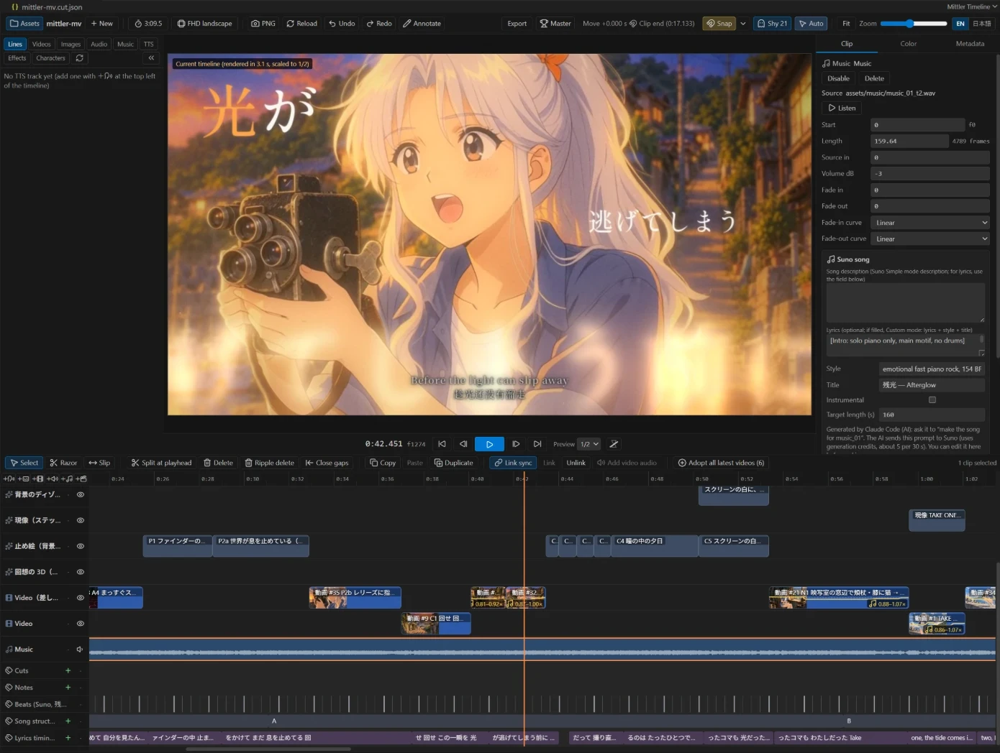

# Mittler



[English](README.md) | 日本語

> Der Mittler zwischen Hirn und Händen muss das Herz sein.
> （頭脳と手の仲介者は、心でなければならない ―『メトロポリス』1927）

**Mittler** は、AI エージェント（Claude Code など）と一緒に使う VS Code 拡張の動画エディタです。
エージェントが生成・編集するタイムラインや Python エフェクトの中身を、VS Code 上のタイムライン画面で確認・操作しながら、AI にそのまま修正を依頼できます。

> **アルファ版（0.9.0）**：作者自身の作品制作では実用していますが、機能・ファイル形式・設定は今後変更される可能性があり、粗い部分も残っています。作品は Git で管理してご利用ください。
>
> **動作環境**：**Windows 専用**です（詳細は [docs/インストールガイド.md](docs/インストールガイド.md) の 12 を参照）。Node.js の別途インストールは不要で（VS Code 内蔵の Node を使用）、npm の依存パッケージもありません。

## 安全について

作品を開くと、その作品フォルダに含まれる Python コード（`effects/*.py`）が実行されます。
**知らない人の作品は、必ず中身を確認してから開いてください。**
なお、VS Code で信頼していないフォルダ（制限モード）では Mittler は動作しません。詳しくは [docs/インストールガイド.md](docs/インストールガイド.md) の 11 をご覧ください。

## 主な特徴

- **VS Code 内で完結する AI 協業**：`*.cut.json` を開くと編集画面が立ち上がります。隣にエージェントを開き、映像を確認・操作しながら修正を頼めます。
- **正本はタイムラインとコードだけ**：正本は `*.cut.json` と `effects/*.py` のみです。これらを Git で管理し、素材（`assets/`）・書き出し（`output/`）・作業ファイル（`work/`）は Git に入れません。
- **時刻ベースで正確な Python 描画**：描画エンジン（`pyengine/mittler`）は時刻 `t` だけでフレームを決定するため、どのコマにも即座にシークでき、一時停止中の 1 コマがそのまま最終書き出しと同じ絵になります。
- **編集画面とエージェントの連動**：選択中のクリップ・現在時刻・表示中の 1 コマが自動でエージェントに伝わり、ファイルが更新されると編集画面も即座に読み直されます。

## できること

詳しい操作方法は [docs/スターターガイド（人間用）.md](docs/スターターガイド（人間用）.md) をご覧ください。

- **プレビューと再生**
  再生・停止（`Space`）、コマ送り（`←` / `→`、`Shift` で 1 秒移動、再生操作バー上でのホイール）、`Home` / `End`、ルーラードラッグでのシーク、`Ctrl`＋ホイールでの拡大に対応します。停止中は本番と同一の 1 コマを描画します（描画中は前のコマを保持）。
- **タイムライン・カット編集**
  選択・カット・スリップ・再生位置での分割・リップル削除・隙間を詰める・コピー＆貼り付け・複数選択・トラック移動・映像と音声のリンク・フェード・波形表示・スナップ。動画の長さ（末尾の外に置くと自動延長）や解像度の変更、トラックの追加・削除、メタデータ（カット・ト書き・セリフ・歌詞）のドラッグもできます。
- **AI への視覚的な指示と状態共有**
  一時停止中の画面にペン・矢印・丸を書き込み、その画像ごとエージェントへ渡せます。また、作品の `.mittler/state.json` とフック（`.mittler/hook.py` → `tools/mittler_state.py`）により、エージェントは編集画面の現在状態を常に把握できます。
- **セリフ・字幕（TTS）**
  Gemini TTS / VOICEVOX によるセリフ生成に対応。テイク管理、シーンごとの演技指定、未生成分の一括生成・再生成、セリフからの字幕作成が行えます。
- **動画化予定・音楽生成との連携**
  開始・終了フレームの画像生成から下書き動画化（ステップ数削減・シード固定）、テイク比較・採用までを編集画面上で進められます（生成エンジンは `tools/engines.json` のアダプタで差し替え可能）。Suno の楽曲もエージェントが生成し、編集画面でテイクを選んで採用できます。
- **速度調整・音ハメ・クリップ解析**
  映像の速度調整、動きのキメを拍に合わせる音ハメ、フッテージの延長に対応します。クリップの右クリックから拍検出・文字起こし・ボーカル／伴奏分離・人物ポーズ・マスク・切り抜きを実行できます（解析用 Python が必要。インストールガイドの 9）。
- **書き出し・高画質化**
  品質・範囲（全体／一部）・ファイル名を指定し、区間分割の並列描画で `output/<名前>.mp4` に書き出します（SHA-256 を出力、途中キャンセル可能）。60fps のマスター書き出し（高画質は 4K 描画後に縮小）や、動画 1 本を高画質化する `tools\enhance.cmd` も利用できます。

## インストール

### 配布版（VSIX）から入れる（おすすめ）

1. VS Code の「拡張機能」→ 右上の「…」→「**VSIX からのインストール…**」から `mittler-<版>.vsix` を選びます（コマンドラインなら `code --install-extension mittler-<版>.vsix`）。
2. インストール後に右下の通知が表示されるので、「**Mittler: 初期設定**」→「描く python を入れる…」の順に進めます。

> VSIX をこのリポジトリからビルドする場合は `python tools\build_vsix.py` を実行します（`dist/` に生成。詳細は [docs/配布.md](docs/配布.md)）。

### リポジトリを clone して入れる（開発版）

VSIX を使わずに導入したい場合や、Mittler 本体を改修したい場合の手順です。
事前に **VS Code・Python 3.12 以上・ffmpeg（full build）・Git** を用意してください（Node.js は不要）。

1. リポジトリを clone し、不足している環境を確認します（何も変更せず、不足項目と導入手順を一覧表示します）。
   ```powershell
   git clone https://github.com/sa-san10/mittler.git mittler
   cd mittler
   python setup\mittler_setup.py
   ```
2. 描画用の Python 仮想環境を作成し、VS Code に拡張を登録します（先に `--dry-run` を付けると実行内容だけ確認できます）。
   ```powershell
   python setup\mittler_setup.py --install-venv <venv を作るフォルダ> --install-extension
   ```
   - `--install-venv`：指定フォルダに venv を作成し、numpy・OpenCV・Pillow をインストールします。
   - `--install-extension`：clone したフォルダを直接読み込む開発版の入口を VS Code に登録します（`python tools\install_vscode.py` と同等）。
3. 最後に表示される設定行（`"mittler.render.python": "…"` など）を VS Code の `settings.json` に追記し、「**ウィンドウの再読み込み**」を実行します。
4. もう一度 `python setup\mittler_setup.py` を実行し、不足がなければ完了です。

> **エージェントに任せる場合**：clone したフォルダを VS Code で開き、エージェントに「**Mittler の初期設定をして**」と伝えるだけで 1〜4 を進められます（[AGENTS.md](AGENTS.md) に従い、インストール前に確認を求めます）。

#### 言語設定とオプション機能

- **表示言語**：初期状態は英語です。編集画面の上部バー右端の「日本語」ボタン、または設定 `"mittler.language": "ja"` で日本語に切り替えられます。
- **オプション機能**：Gemini API キー（セリフ）・画像生成 API キー・解析用 AI・Real-ESRGAN／RIFE・Blender がなくても基本機能は動作します。使う機能に応じて後から導入できます（[docs/インストールガイド.md](docs/インストールガイド.md)）。

## 使い方

### 新しい作品を作る

次のいずれかの方法で、ひな形（`templates/`）から新しい作品フォルダを作成できます。

- 編集画面の上部バーにある「**＋ 新規**」ボタン
- VS Code のコマンドパレット（`Ctrl+Shift+P`）→「**Mittler: 新しい作品を作る**」
- 空のフォルダでエージェントに「**Mittler で新しいプロジェクトを始めたい**」と依頼する（Claude Code スキル）
- コマンドラインから `tools/new_project.js` を実行する

### VS Code で編集する

作品フォルダの `*.cut.json` を VS Code で開くと編集画面が表示されます。
生の JSON として確認したい場合は、コマンド「**Mittler: JSON として開く**」を使用します。

- **開発版の更新**：リポジトリを更新したら VS Code で「ウィンドウの再読み込み」を行います（`package.json` が変更された場合のみ、`python tools\install_vscode.py` を再実行してください）。
- 配布版と開発版の切り替え方は [docs/インストールガイド.md](docs/インストールガイド.md) の 2 を参照してください。

### VS Code なしで起動する（ブラウザ・テスト用）

```powershell
tools\mittler.cmd serve <作品>\<名前>.cut.json --port 47811
```

起動時の 1 行目に、トークン付きの編集画面 URL が出力されます。

- **試し用作品の作成**：大事な作品で試さず、空のフォルダにテスト用の作品を作成してください。
  ```powershell
  tools\mittler.cmd node tools\new_project.js <フォルダ> --title 試し
  ```
- **動作確認**：`tools\smoke_*.py` を実行します（各テストの対象と前提条件は [AI 用ガイド](docs/スターターガイド（AI用）.md) の 7 を参照）。

## 動作環境・描画設定

描画は VS Code 拡張が動いている PC で実行されます。作品フォルダ（`*.cut.json`・`effects/`・`assets/`）も同じ PC に配置し、書き出し結果は同 PC の `output/` に保存されます。

- **描画用 Python と ffmpeg の指定**
  描画用 Python には numpy・OpenCV・Pillow が必要です（`setup/requirements-engine.txt`）。PC ごとの VS Code `settings.json` で設定します。
  ```json
  "mittler.render.python": "C:\\path\\to\\venv\\Scripts\\python.exe",
  "mittler.render.ffmpegDir": "C:\\path\\to\\ffmpeg\\bin"
  ```
  - **Python の探索順**：VS Code 設定 → タイムラインの `render.python`（未設定なら既定の場所）→ `PATH` 上の `python`（見つからない場合は編集画面に表示されます）。
  - **ffmpeg の探索順**：VS Code 設定 → 既定の場所 → `PATH`。
  - その他の設定（解析用 Python・VOICEVOX・プリセットなど）と既定値の一覧は [docs/インストールガイド.md](docs/インストールガイド.md) の 12 にまとめています（既定値は `server/defaults.js` に集約）。
- **VS Code なしでパスを指定する場合**
  ```powershell
  tools\mittler.cmd serve <作品>\xxx.cut.json [--render-python <python>] [--ffmpeg-dir <ffmpeg の bin>]
  ```
  その他のオプションもインストールガイドの 12 を参照してください。
- **GPU マシンなど別 PC で描画する場合**
  VS Code の Remote-SSH で接続して利用します（[docs/インストールガイド.md](docs/インストールガイド.md) の 10）。
- **セリフ生成の条件**
  Gemini の API キー（Windows 資格情報マネージャーまたは環境変数 `GEMINI_API_KEY`）か、VOICEVOX がある PC でのみ動作します。
- **複数台での運用**
  正本は 1 か所に保ち、同じ作品を 2 台で同時に編集しないでください。タイムラインと `effects/` は Git で同期し、素材は一度コピーして共有します。

## ドキュメント

> **文書について**：文書の多くは、AI エージェントが読むために AI が書いたものです。エージェントが Mittler をどう動かすかを決める内容なので、人が通して読む説明書というより「日本語で書かれたコード」として扱っています。読みにくい所・コードと食い違う所・エージェントを誤らせる書き方は**バグ**です。Issue で知らせてください（`CONTRIBUTING.md`）。必要な所だけ AI エージェントに説明してもらうのが、いちばん早い読み方です。

| 目的・対象 | ドキュメント |
|---|---|
| **初めての方（短い入口）** | **[docs/スターターガイド.md](docs/スターターガイド.md)**（入れ方・初期設定・新規作成・作業開始・書き出し） |
| AI エージェント向け | [AGENTS.md](AGENTS.md) → [docs/スターターガイド（AI用）.md](docs/スターターガイド（AI用）.md) |
| 編集画面と操作の詳細 | [docs/スターターガイド（人間用）.md](docs/スターターガイド（人間用）.md) |
| 導入・設定一覧・安全 | [docs/インストールガイド.md](docs/インストールガイド.md)（セットアップ用スクリプトは `setup/`） |
| ファイル形式・エフェクト作成 | [docs/タイムライン形式.md](docs/タイムライン形式.md) / [docs/エフェクトの書き方.md](docs/エフェクトの書き方.md) |
| コード構成・アーキテクチャ | [docs/ARCHITECTURE.md](docs/ARCHITECTURE.md) |
| 生成連携の仕様 | [docs/H3受け渡し契約.md](docs/H3受け渡し契約.md)（動画生成） / [docs/Suno受け渡し契約.md](docs/Suno受け渡し契約.md)（曲） |
| 動画制作の技術メモ | [docs/技術集/](docs/技術集/README.md)（人物マスク・拍・歌詞タイミング・音ハメ・口パク・文字演出など） |

## リポジトリ構成

| パス | 役割 |
|---|---|
| `AGENTS.md` / `CLAUDE.md` | エージェントが最初に読む入口（`CLAUDE.md` は Claude Code に `AGENTS.md` を読ませるためのもの） |
| `extension.js` / `package.json` | VS Code 拡張本体。`*.cut.json` を開くとローカルサーバーを起動し、編集画面を表示 |
| `server/` | ローカルサーバー（`server.js`：127.0.0.1 限定・起動ごとのトークン認証。詳細はインストールガイドの 11）、単体起動（`main.js`）、描画サーバー管理（`pyrender.js`）、既定値（`defaults.js`）、名前定義（`names.js`）、Suno 曲の受け取り（`music.js`）、動画化予定のプロンプト参照（`plan_refs.js`）、原子的ファイル更新（`atomic.js`） |
| `editor/` | 編集画面のフロントエンド（素の HTML / JS。ファイルごとの役割は [docs/ARCHITECTURE.md](docs/ARCHITECTURE.md)） |
| `pyengine/mittler/` | Python 描画エンジン（1 コマ描画・描画サーバー・書き出し・音声・字幕・音量正規化・音ハメ・解析・マスター書き出し） |
| `effects_lib/` | エフェクトの部品集。`common/`（字幕・重ね絵・フェード・色：新規作品に配布。ほかに 3D）、`false_maria/`（コードのみで描画する偽マリアのエフェクト 6 本）、`beatfx/`（拍連動演出）。部品一覧に表示するフォルダは `library.json` で管理 |
| `tools/` | 補助ツール群：`mittler.cmd`（VS Code 内蔵 Node で実行）、`new_project.js`、`install_vscode.py`、`mittler_api.py`（エージェントから生成・解析を依頼）、`mittler_state.py`（フック）、`jobs.py`（生成ジョブ管理）、各生成アダプタ（`h3_jobs.py` / `codex_jobs.py` / `openai_image_jobs.py` / `gemini_image_jobs.py`、対応表は `engines.json`）、`smoke_*.py`（動作確認） |
| `setup/` | 初期設定チェック（`mittler_setup.py`）、Python パッケージ一覧、API キー確認、Claude Code スキル導入ツール |
| `templates/` / `skills/` | 新規作品のひな形 / Claude Code 用スキル（新しい作品を始める） |
| `docs/` | 上記「ドキュメント」一覧にある各種ガイド・仕様書 |

## ライセンス

[MIT License](LICENSE)（Copyright (c) 2026 sa-san10）

- 描画に使用する Python パッケージ（numpy・OpenCV・Pillow、3D 利用時は moderngl）および ffmpeg・Blender は同梱していません。各ソフトウェアのライセンスに従います（一覧は [THIRD_PARTY_NOTICES.md](THIRD_PARTY_NOTICES.md)）。
- 編集画面のアイコンは [Lucide](https://lucide.dev)（ISC ライセンス）を改変せず `editor/icons/` に同梱しています（ライセンス本文を含む）。
