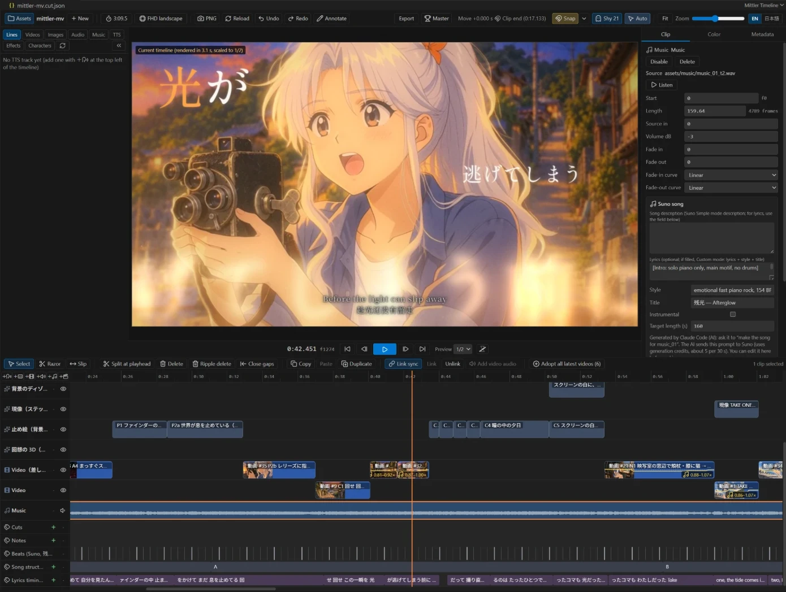

# Mittler



English | [日本語](README.ja.md)

> Der Mittler zwischen Hirn und Händen muss das Herz sein.
> (*Metropolis*, 1927)

**Mittler** is a video editor extension for VS Code designed to work alongside an AI agent (such as Claude Code).
It lets you inspect and edit timelines and Python effects created by your agent directly on a timeline UI in VS Code, and ask the agent for changes while looking at the exact frame.

> **Alpha (0.9.0)**: Mittler is actively used for the author's own productions, but features, file formats, and settings may still change, and rough edges remain. Keep your projects under Git version control.
>
> **Environment**: **Windows only** (see [docs/インストールガイド.md](docs/インストールガイド.md), section 12). Separate Node.js installation is not required (it uses VS Code's built-in Node), and there are no npm dependencies. The editor UI is available in English and Japanese; detailed documentation is in Japanese.

## Safety

Opening a project executes Python code (`effects/*.py`) inside that project folder.
**Only open projects you trust, and always inspect projects from other people before opening them.**
Mittler does not run in folders that VS Code has not trusted (Restricted Mode). See [docs/インストールガイド.md](docs/インストールガイド.md), section 11 for details.

## Key Features

- **AI collaboration inside VS Code**: Open any `*.cut.json` file to launch the editor. Keep your agent open next to it to review, scrub, and request edits together.
- **Timeline and code as the single source of truth**: Only `*.cut.json` and `effects/*.py` are tracked in Git. Media (`assets/`), renders (`output/`), and work files (`work/`) stay out of Git.
- **Deterministic, time-based Python rendering**: The rendering engine (`pyengine/mittler`) computes each frame solely from time `t`, enabling instant seeking to any frame and ensuring every paused frame matches the final export.
- **Live sync between editor and agent**: The selected clip, playhead time, and current frame are shared automatically with the agent, and any changes the agent writes to timeline or effect files reload immediately in the editor.

## What It Can Do

For detailed controls and workflows, see [docs/スターターガイド（人間用）.md](docs/スターターガイド（人間用）.md) (Japanese).

- **Preview and playback**
  Play/pause (`Space`), frame stepping (`←` / `→`, `Shift` for 1-second jumps, mouse wheel over the transport bar), `Home` / `End`, ruler-drag scrubbing, and `Ctrl` + wheel zoom. Pausing renders the exact final-quality frame (holding the previous frame while rendering).
- **Timeline and cut editing**
  Select, cut, slip, split at playhead, ripple delete, close gaps, copy/paste, multi-select, track moves, audio/video linking, fades, waveforms, and snapping. Supports changing video duration (automatically extends when placing clips past the end) and resolution, adding/removing tracks, and dragging metadata (cuts, stage directions, dialogue, lyrics).
- **Visual annotations and state sharing with AI**
  Draw pens, arrows, and circles directly onto a paused frame and hand the annotated image to your agent. Through `.mittler/state.json` and hooks (`.mittler/hook.py` → `tools/mittler_state.py`), the agent always knows what you are currently viewing and selecting.
- **Dialogue and subtitles (TTS)**
  Generate speech lines with Gemini TTS or VOICEVOX. Includes take management, per-scene acting instructions, batch generation/regeneration of missing lines, and automatic subtitle generation from dialogue.
- **Planned shots and music generation**
  Generate start/end frames, create draft video renders (reduced steps with fixed seeds), compare takes, and adopt winners right in the editor (engines are swappable via adapters in `tools/engines.json`). Songs generated by your agent with Suno can also be auditioned and adopted from the editor.
- **Speed control, beat sync, and clip analysis**
  Adjust clip speed, align motion accents to beats, and extend footage. Right-click clips to run beat detection, transcription, vocal/accompaniment separation, pose estimation, masking, and cutout (requires analysis Python; see `docs/インストールガイド.md`, section 9).
- **Export and upscaling**
  Choose quality, range (full or partial), and filename to render segments in parallel to `output/<name>.mp4` (outputs SHA-256; cancellable mid-export). Also supports 60 fps master exports (high-quality mode renders at 4K and downscales) and standalone video upscaling via `tools\enhance.cmd`.
- **Effect library**
  In the editor's *Effects* tab, the effect library lists ready-made effects you can add to a project with one click, including 3D effects (GPU / Blender) and the **False Maria effects** (light and tone map, edge neon, shutter flash, gamma and saturation, fade to black with credits, flying hearts), which are drawn purely in code and need no images.

## Installation

### From VSIX (Recommended)

1. In VS Code, go to *Extensions* → `…` → **Install from VSIX…** and select `mittler-<version>.vsix` (or run `code --install-extension mittler-<version>.vsix`).
2. After installing, a notification appears once in the bottom-right corner: if the rendering Python or ffmpeg is missing, it says so and offers **Mittler: Setup**; otherwise it offers **New Project**.
3. Run **Mittler: Setup** (from that notification or the Command Palette). It checks what is missing and, only when you press the button, creates a Python environment for rendering (numpy, OpenCV, Pillow; optionally moderngl for GPU 3D). ffmpeg and Python themselves are installed by you (it shows the `winget` commands).
4. Create a project with **Mittler: New Project** (or **＋ New** in the editor), then open its `*.cut.json`.

> To build the VSIX from this repository, run `python tools\build_vsix.py` (outputs to `dist/`; see [docs/配布.md](docs/配布.md)).

### From a Repository Clone (Development)

Use this method if you prefer not to use a VSIX or want to modify Mittler itself.
Ensure **VS Code, Python 3.12 or later, ffmpeg (full build), and Git** are installed first (Node.js is not required).

1. Clone the repository and check your environment (changes nothing; lists missing requirements and install instructions):
   ```powershell
   git clone <repository URL> mittler
   cd mittler
   python setup\mittler_setup.py
   ```
2. Create the rendering Python virtual environment and register the development extension in VS Code (add `--dry-run` first to preview what will run):
   ```powershell
   python setup\mittler_setup.py --install-venv <venv folder> --install-extension
   ```
   - `--install-venv`: Creates a virtual environment in the specified folder and installs numpy, OpenCV, and Pillow.
   - `--install-extension`: Registers a loader in VS Code that runs directly from your cloned repository (equivalent to `python tools\install_vscode.py`).
3. Add the printed settings lines (such as `"mittler.render.python": "…"`) to your VS Code `settings.json`, then run **Developer: Reload Window**.
4. Run `python setup\mittler_setup.py` again and confirm nothing is missing.

> **Let an agent do it**: Open the cloned folder in VS Code and tell your agent **"Set up Mittler"**. It follows [AGENTS.md](AGENTS.md) and asks for confirmation before installing anything.

#### Language and Optional Features

- **Display language**: English by default. Switch to Japanese using the language button at the right end of the editor's top bar, or set `"mittler.language": "ja"`.
- **Optional features**: Core features work without a Gemini API key (speech), image-generation keys, analysis AI tools, Real-ESRGAN/RIFE, or Blender. Install them later only for the features you need ([docs/インストールガイド.md](docs/インストールガイド.md)).

## Requirements

- Windows, VS Code 1.90 or later
- Python 3.12 or later with numpy, OpenCV, and Pillow for rendering (**Mittler: Setup** can install them)
- ffmpeg (for video decoding and export)
- Optional: moderngl (GPU 3D effects), Blender (Blender 3D effect), a Gemini API key or VOICEVOX (speech)

## Usage

### Creating a New Project

Create a new project folder from `templates/` using any of the following:

- Click **＋ New** in the editor's top bar
- Open the VS Code Command Palette (`Ctrl+Shift+P`) → **Mittler: New Project**
- Open an empty folder and ask your agent to start a new Mittler project (Claude Code skill)
- Run `tools/new_project.js` from the command line

### Editing in VS Code

Open any `*.cut.json` file in your project folder to launch the editor UI.
To inspect the raw JSON text, run **Mittler: Open as JSON**.

- **Updating the development version**: After pulling updates, run **Developer: Reload Window** in VS Code (re-run `python tools\install_vscode.py` only when `package.json` has changed).
- See [docs/インストールガイド.md](docs/インストールガイド.md), section 2 for switching between the VSIX release and the development version.

### Running Without VS Code (Browser / Testing)

```powershell
tools\mittler.cmd serve <project>\<name>.cut.json --port 47811
```

The first line of output prints the editor URL with its session token.

- **Create a throwaway test project**: Avoid testing on real projects; create a test project in an empty folder instead:
  ```powershell
  tools\mittler.cmd node tools\new_project.js <folder> --title test
  ```
- **Smoke tests**: Run `tools\smoke_*.py` (see [docs/スターターガイド（AI用）.md](docs/スターターガイド（AI用）.md), section 7 for each script's scope and prerequisites).

## Environment & Rendering Settings

Rendering runs on the PC where the VS Code extension is active. Keep the project folder (`*.cut.json`, `effects/`, `assets/`) on that PC; exports are written to its `output/` folder.

- **Configuring rendering Python and ffmpeg**
  The rendering Python requires numpy, OpenCV, and Pillow (`setup/requirements-engine.txt`). Configure paths per machine in VS Code `settings.json`:
  ```json
  "mittler.render.python": "C:\\path\\to\\venv\\Scripts\\python.exe",
  "mittler.render.ffmpegDir": "C:\\path\\to\\ffmpeg\\bin"
  ```
  - **Python lookup order**: VS Code setting → timeline's `render.python` (or default location if unset) → `python` on `PATH` (if none is found, the editor notifies you).
  - **ffmpeg lookup order**: VS Code setting → default location → `PATH`.
  - See [docs/インストールガイド.md](docs/インストールガイド.md), section 12 for all settings (analysis Python, VOICEVOX, presets, etc.) and defaults (centralized in `server/defaults.js`).
- **Passing paths without VS Code**
  ```powershell
  tools\mittler.cmd serve <project>\xxx.cut.json [--render-python <python>] [--ffmpeg-dir <ffmpeg bin>]
  ```
  Additional CLI flags are also listed in `docs/インストールガイド.md`, section 12.
- **Rendering on another PC (e.g., a GPU workstation)**
  Connect to that machine via VS Code Remote-SSH ([docs/インストールガイド.md](docs/インストールガイド.md), section 10).
- **Speech generation (TTS) requirements**
  Requires either a Gemini API key (Windows Credential Manager or `GEMINI_API_KEY` environment variable) or a running VOICEVOX instance on the rendering PC.
- **Multi-PC workflow**
  Keep a single source of truth and avoid editing the same project on two machines simultaneously. Sync the timeline and `effects/` via Git, and copy media assets separately.

## Documentation (Japanese)

> **About these documents**: most of them are written by and for AI agents. They describe how an agent should operate Mittler, so treat them like code written in Japanese rather than a manual meant to be read cover to cover. If something is hard to follow, disagrees with the code, or leads an agent astray, that is a bug: please report it as an issue (see `CONTRIBUTING.md`). Asking an AI agent to explain the parts you need is usually the fastest way in.

| Audience / Topic | Document |
|---|---|
| **First-time users (quick start)** | **[docs/スターターガイド.md](docs/スターターガイド.md)** (installation, setup, new project, workflow, export) |
| AI agents | [AGENTS.md](AGENTS.md) → [docs/スターターガイド（AI用）.md](docs/スターターガイド（AI用）.md) |
| Editor UI and controls | [docs/スターターガイド（人間用）.md](docs/スターターガイド（人間用）.md) |
| Installation, settings, and safety | [docs/インストールガイド.md](docs/インストールガイド.md) (setup scripts live in `setup/`) |
| Timeline format and writing effects | [docs/タイムライン形式.md](docs/タイムライン形式.md) / [docs/エフェクトの書き方.md](docs/エフェクトの書き方.md) |
| Code layout and architecture | [docs/ARCHITECTURE.md](docs/ARCHITECTURE.md) |
| Generation integration contracts | [docs/H3受け渡し契約.md](docs/H3受け渡し契約.md) (video) / [docs/Suno受け渡し契約.md](docs/Suno受け渡し契約.md) (music) |
| Video production techniques | [docs/技術集/](docs/技術集/README.md) (person masks, beats, lyric timing, beat sync, lip sync, text motion, etc.) |

## Repository Structure

| Path | Role |
|---|---|
| `AGENTS.md` / `CLAUDE.md` | Entry point for AI agents (`CLAUDE.md` directs Claude Code to read `AGENTS.md`) |
| `extension.js` / `package.json` | VS Code extension; launches the local server and editor view when opening `*.cut.json` |
| `server/` | Local server (`server.js`: bound to 127.0.0.1 with per-launch token auth; see `docs/インストールガイド.md`, section 11), standalone launcher (`main.js`), render server manager (`pyrender.js`), centralized defaults (`defaults.js`), naming (`names.js`), Suno track intake (`music.js`), planned-shot prompt references (`plan_refs.js`), and atomic file writes (`atomic.js`) |
| `editor/` | Editor frontend (vanilla HTML / JS; per-file roles in [docs/ARCHITECTURE.md](docs/ARCHITECTURE.md)) |
| `pyengine/mittler/` | Python rendering engine (frame rendering, render server, export, audio, subtitles, loudness normalization, beat sync, analysis, master export) |
| `effects_lib/` | Reusable effect library: `common/` (subtitles, overlays, fades, and color, which are copied into new projects; also the 3D effects), `false_maria/` (6 code-only effects requiring no images), and `beatfx/` (beat-reactive effects). Exposed folders are configured in `library.json` |
| `tools/` | Helper tools: `mittler.cmd` (runs via VS Code's Node), `new_project.js`, `install_vscode.py`, `mittler_api.py` (agent-triggered generation/analysis), `mittler_state.py` (hook), `jobs.py` (generation job runner), generation adapters (`h3_jobs.py` / `codex_jobs.py` / `openai_image_jobs.py` / `gemini_image_jobs.py`; mapped in `engines.json`), and `smoke_*.py` (smoke tests) |
| `setup/` | Setup checker (`mittler_setup.py`), Python package lists, API key checker, and Claude Code skill installer |
| `templates/` / `skills/` | New project templates / Claude Code skill for creating new projects |
| `docs/` | Guides and specifications listed under Documentation above |

## License

[MIT License](LICENSE) (Copyright (c) 2026 sa-san10)

- Rendering Python packages (numpy, OpenCV, Pillow; moderngl for GPU 3D), ffmpeg, and Blender are not bundled and remain under their respective licenses (see [THIRD_PARTY_NOTICES.md](THIRD_PARTY_NOTICES.md)).
- Editor icons are [Lucide](https://lucide.dev) (ISC License), bundled unchanged in `editor/icons/` together with their license text.
